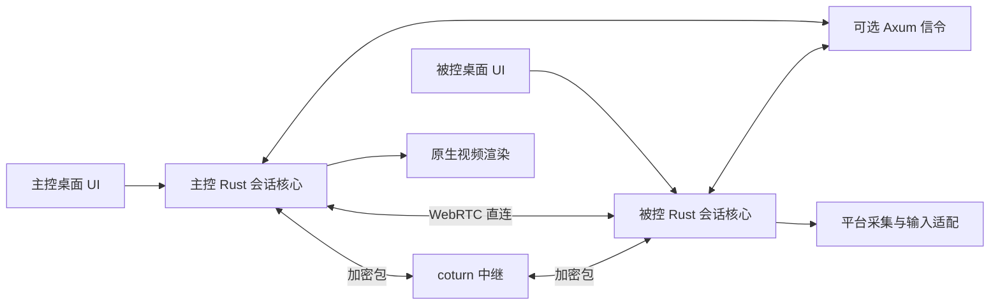

# 技术架构与决策 ADR v0.1

## 决策
- ADR-001 已确认：自主开发，复用成熟底层库；不 fork RustDesk。
- ADR-002 工作基线：Tauri 2 + Vue 3 + TypeScript，Rust 核心/Tokio；具体版本在首次构建时锁定。
- ADR-003 工作基线：WebRTC + ICE/STUN/TURN；信令 Axum + WSS；coturn；SQLite；消息类型以 Protobuf 为目标。最终媒体库及分发方式在 M0 spike 后冻结。
- ADR-004 工作基线：局域网采用本地受控的信令端点与直接身份确认，不依赖公网服务；公网可选自建注册/信令、中继。WebRTC 自身不提供业务身份验证。
- ADR-005 待决：项目许可证、最低支持 OS、媒体引擎/原生渲染与硬件编码分发方案。MIT 是候选而非已授予许可。

## 逻辑架构

信令不转发媒体；TURN 不终止媒体端到端加密。注册与授权不是同一件事。双方确认身份和权限后才启动对应资源。LAN 信令不得默认监听所有地址且不得以“内网可信”替代身份校验。

## 模块边界
| 模块 | 职责 |
|---|---|
| apps/desktop | Tauri 生命周期、Vue UI、窗口、托盘、受限 IPC |
| crates/core | 会话状态机、设备管理、能力协商、服务配置 |
| crates/protocol | 版本化 wire schema、消息类型、大小与语义验证 |
| crates/security | 设备密钥、身份确认、授权校验、信任撤销 |
| crates/transport | WebRTC 适配、ICE、数据通道、连接统计 |
| crates/capture | 屏幕枚举、帧、格式、时间戳、游标 |
| crates/codec | 媒体 pipeline 与编码/解码能力选择 |
| crates/renderer | 原生或零/低拷贝渲染、缩放、坐标映射 |
| crates/input | 键鼠事件、按键状态、坐标映射、权限验证 |
| crates/audio | 音频设备及媒体轨 |
| crates/clipboard | 双向授权、格式与大小限制 |
| crates/file-transfer | 独立流控、校验、冲突策略 |
| crates/platform | OS 权限、后台服务、进程 IPC |
| servers/signaling | 注册、挑战认证、会话路由、限流、TURN 临时凭据 |
| deploy | 自建信令与 TURN，环境变量模板、TLS 与部署文档 |

目录按实际实现逐步建立，不创建无功能占位模块来宣称完成。

## 媒体数据路径
原生屏幕采集 -> 像素缓冲/颜色转换 -> 编码 -> RTP/WebRTC -> 解码 -> 原生窗口 GPU 渲染。Tauri IPC 仅用于控制、事件和统计，禁止逐帧 base64/JSON。GStreamer 优先验证 webrtcbin、平台硬件编码、接收端解码与原生窗口渲染；若不能满足可维护性/打包要求，再比较 libwebrtc 或 webrtc-rs + 独立媒体 pipeline。不能假设这些方案的互操作和硬件能力已经验证。

## 平台适配
| OS | 采集候选 | 输入候选 | 编解码候选 | 注意事项 |
|---|---|---|---|---|
| Windows | WGC / DXGI | SendInput | Media Foundation | DPI、UIPI、安全桌面；服务与用户会话隔离 |
| macOS | ScreenCaptureKit | CGEvent | VideoToolbox | TCC 屏幕录制/辅助功能，签名及权限持久性 |
| Linux X11 | X11/XShm | XTest | VA-API 等 | 显示会话与权限 |
| Linux Wayland | PipeWire + ScreenCast Portal | RemoteDesktop Portal/EIS | VA-API 等 | Compositor 差异；用户授权不可绕过 |

## 数据与部署
本地 SQLite：settings、devices、trusted_peers、session_history、transfer_history；私钥/敏感凭据单独由平台安全存储或受 OS 权限保护的密钥存储管理，禁止硬编码全局密钥。服务器 SQLite 初期仅保留 device_id/public_key/注册状态/必要审计；在线与路由状态短期内存保存。多实例扩展再考虑 PostgreSQL/共享状态。部署可独立替换信令与 coturn，默认无公共实例地址。信令 HTTPS/WSS，TURN UDP/TCP/TLS；按部署环境显式开放防火墙与中继端口，关闭开放匿名 relay。

## 上游参考
- https://v2.tauri.app/concept/architecture/
- https://gstreamer.freedesktop.org/documentation/webrtc/
- https://gstreamer.freedesktop.org/documentation/frequently-asked-questions/licensing.html
- https://github.com/coturn/coturn
- https://developer.apple.com/documentation/screencapturekit
- https://learn.microsoft.com/en-us/windows/win32/direct3ddxgi/desktop-dup-api
- https://flatpak.github.io/xdg-desktop-portal/docs/

## ADR-006：M1 单帧本地诊断实现

Tauri 2/Vue3 桌面应用采用独立 Cargo workspace，避免原生 GUI 依赖污染核心 CI。XCap 0.9.10 是显示器枚举和单次本地 PNG 预览的候选依赖；只在本机明确操作后执行，限制尺寸、并发及频率，不持久化图片、不开放网络服务。Tauri raw IPC 只用于有限的单次诊断，连续媒体不得使用该接口。XCap 并非已冻结的视频引擎；连续屏幕采集、GStreamer/WebRTC 媒体及低拷贝渲染仍需实际验证。平台编译与依赖许可证尚待确认。

## ADR-007：原生 WebRTC 媒体模块

crates/media 独立 Cargo workspace，GStreamer 1.20+ 与 gstreamer-rs 0.23。初始 VP8/RTP，webrtcbin 信令动作、SDP/ICE、有界事件队列，appsrc 接收原生 RGBA、appsink 输出 GstSample。两端进程内信令的合成视频闭环是首个运行门槛，不代表公网或实际桌面可用。M1 单视频 m-line，无 renegotiation、数据通道、TURN 或远程监听。媒体和桌面暂未集成。原生帧接入必须由已验证授权的会话 owner 控制；实际身份确认及双方签名校验前只允许合成媒体或不含敏感像素的占位源，真实采集不得提前进入发送管线。

## ADR-008：ICE 完成消息与本地原生画面验证

GStreamer 1.24+ 的候选完成标记可能是空字符串，不能作为无效候选拒绝。保持单 m-line、消息长度及字符限制。M1 诊断增加 appsrc 原生合成 RGBA 输入与可选 autovideosink 渲染，真实屏幕路径由可选 local-screen feature、交互确认和已连接的两个本进程 peer 约束；仍非生产连续采集方案。禁止对外部设备开放真实屏幕或输入，直至完成实际身份/授权和安全信令。后续替换重复截图为原生连续帧源并优化缩放、宽高比、stride、显示器切换及 GPU 路径。

## ADR-009：独立进程 LAN 诊断

crates/signaling 是 portable workspace 成员，实现版本化、有界 JSON 消息及 TCP 长度帧；只用于单连接诊断，不是生产信令服务。显式绑定指定 loopback/RFC1918 地址，限制候选、消息、总时限；无通配地址、公网监听、注册、TURN 或 TLS。JSON 为该诊断控制面选择；原有 Protobuf 输入数据协议不变。生产信令协议需在 M2 冻结，不能默认将诊断格式直接对公网暴露。

GStreamer 原生模块增加协商型（negotiated）可靠有序 SCTP 数据通道；固定 channel id 0、输入 v1、单通道消息限长/有界队列。为使用 send_data_full 提升该媒体模块运行时最低版本至 GStreamer 1.22；原 VP8 loopback 继续验证。

lan_diagnostic 两端各自生成临时密钥，双方在可信途径确认完整公钥并手动批准测试；显式监听/连接、一次性配对、原始 SDP 双签名、ICE 交换、DTLS/SCTP 连接。仅合成视频与固定测试输入序列，验证 SessionGate 的 action 和释放计划，不调用任何系统输入接口。控制端为生成 answer 必须预先应用 offer；此时不交换实际桌面和敏感数据。生产阶段须进一步完成安全评审、持久信任、身份与连接生命周期绑定、加密信令及真实同意流程。

## ADR-010：桌面诊断会话进程隔离

桌面采用固定名称、与自身可执行文件同目录的可信本地构建 lan_diagnostic（Windows .exe）作为诊断媒体子进程；不从 PATH 查找，不提供用户任意程序路径或 shell。Tauri main window 仅暴露 prepare/status/confirm/disconnect 四个受限命令，后端校验具体私网/loopback 地址、公钥长度、显式确认、单活动会话。子进程输出解析固定里程碑，输出/命令有界；监督线程负责180秒截止、取消、退出和 kill/wait，主窗口关闭/应用退出清理。此设计隔离媒体原生依赖，但不是已签名或打包的 sidecar；缺失文件会明确提示。UI 支持双端公钥核对、本地授权、真实连接状态、主动断开、成功/失败与可选合成视频原生窗口，连接进行中禁止切换导航。正式版本需要经过签名的媒体组件打包、进程 IPC 审查、持久密钥、加密信令及真实权限集成。

## ADR-011：独立加密只读屏幕路径

生产候选安全通道采用 Snow 的 Noise KK (X25519/ChaChaPoly/BLAKE2s) 双方预先核对完整临时公钥，原始诊断 TCP framing 不再承载真实桌面会话。独立 lan_view CLI 在两端交互确认、Noise 信令加密、Ed25519 双签名绑定 SDP、实际视频 DTLS 证书 SHA-256 校验、双端 Ready 后，才允许 appsrc 获得 XCap 真实屏幕像素。单视频 m-line、view-only、固定显示器、有界帧与 10fps/960×540 letterbox、30秒会话期限、加密 heartbeat、无远程系统输入/无人值守/文件/剪贴板。无自动升级诊断权限；--test 与真实屏幕 profile 必须一致。当前 CLI 不替换桌面诊断界面、不使用未签名 GUI sidecar 做实际屏幕共享。依赖雪库、GStreamer、XCap 及跨平台运行时需要审计、锁定和实机验证。正式连续采集、持久身份、撤销 UI、更多能力、生产信令/发布均未实现。

## ADR-012：桌面只读会话与原生输入适配

桌面新增 screen / secure_test / diagnostic 三个固定 profile，绑定各自媒体可执行文件名、参数、公钥长度及明确的授权语句。真实 host 必须选择显示器 ID；预先核对 128 hex 完整公钥 bundle，保留本机 UI 中可见状态及断开入口，仍限 30 秒、VIEW-only。lan_view --desktop-session 使用专用监督管道，批准后父进程持续持有 stdin；EOF/额外字节即退出只读子进程。正常命令行真实模式仍要求交互终端。可信组件开发期手工安装，未完成生产签名或校验；真实模式不通过旧明文诊断链路。

crates/input 加入 portable workspace；Dispatcher 串行校验 SessionGate、消息顺序、授权区域、指针状态和速率，跟踪真实尝试的按下键及按钮，失败/关闭时尽力释放；释放失败需报告和重试，不承诺 kill/崩溃时能自动释放。原生候选为 Enigo 0.6.1（Windows/macOS 可选 native feature），仅普通桌面、主显示器和常用物理 HID 键。独立编译与 inert fake backend 测试，未接网络输入/OS 操作命令。后续正式输入 owner 必须完成完整 DTLS/SCTP 绑定、单独本机输入授权、控制端事件采集、屏幕坐标/黑边/DPI 对齐、撤销及正常释放，不能复用只读授权。

## ADR-013：原生控制原型及开发构建

新增 lan_control 独立 profile，VIEW|INPUT 双方授权，Noise 信令、签名 SDP、真实视频与 SCTP 证书检查、可信 Ready；默认 --test 仅合成画面与 inert backend，真实 --control 必须在可见交互终端启动。Windows/macOS native-control feature：XCap 主屏、Enigo 普通权限输入、minifb 固定 native 窗口、等比 geometry、焦点及黑边判断、物理键映射。输入 dispatch 与资源释放同进程；不使用强制杀进程作为正常控制断开。30秒限制，心跳2秒、Ctrl-C、Escape、窗口关闭、传输失败结束。控制端关闭前 ReleaseAll，停止消息后被控端 Dispatcher::close，再发送释放回执。异常硬退出、阻塞原生采集、OS release 失败需要后续改进。只读 GUI 保持独立；真实控制仍未接到桌面会话管理。

新增 Windows/macOS development-build workflow，官方 GStreamer 1.26.11 SDK + SHA256，构建 desktop 和媒体程序的同目录测试包；macOS ad-hoc 签名，Windows 无签名，GStreamer runtime 用户单独从官方安装。CI artifacts 并非正式 release。运行时打包/插件许可、稳定签名和安装器仍需完成。

## ADR-015：M2.1 rendezvous 服务

servers/signaling 加入 workspace，Axum 0.8、Tokio、WebSocket JSON v1；独立于 M1 本地媒体路径。开发二进制只允许 IPv4 loopback。每连接一次 Ed25519 challenge、full SHA-256 公钥指纹作为设备路由 ID；内存在线表、每设备一个路由会话，明确 host 请求/许可/拒绝、两端 nonce、SDP offer/answer/proof/ICE 角色与顺序约束、连接/队列/长度/速率/有效期限制、断开清理。服务器只路由协商消息，不代表对端认证或实际桌面权限，不转发媒体/输入。注册凭证须在未来经可信 WSS 验证服务器身份；此开发版 ephemeral server id 不替代 TLS。设备持久身份、客户端接入、端到端加密协商、生产防滥用、TURN 和部署仍待。首版 64 hex 完整 ID 并非最终用户易用展示码；不作短 ID 或密码设计承诺。

## ADR-016：开发包平台运行修复

官方 GStreamer 1.26.11 SDK 下 Windows/macOS native-control release 已编译；macOS 运行时报缺失 LC_RPATH，build.rs 将官方 framework 的固定 lib 路径链接进媒体二进制。开发包改为 Remote EX.app，固定 sidecars 位于 Contents/MacOS，plutil/codesign 校验、ad-hoc签名；依旧外部官方运行时，非 notarized installer。Windows nonblocking listener accept 后恢复 bounded blocking TCP 模式；保留原超时，加跨平台信令单测。修复待完整运行复验。开发包包括 BUILD_INFO；不取消已开始的上一个跨平台 build，最新提交单独排队。

## ADR-017：M2.2 显式注册与持久身份

共享 crates/rendezvous-protocol，server 保留 re-export；crates/rendezvous-client 使用 tokio-tungstenite/rustls，验证 CA、证书与主机名，另校验配置的非零 server ID（部署标识，不是独立密码学证书）；明文只允许明确选择的数字 IPv4 回环开发。WSS 无降级，自签/私有 CA 必须由 CLI 显式提供信任根，GUI 当前使用 WebPKI roots。服务端 axum-server 0.8 可选 cert/key/server ID 全量配置，仍只绑定 IPv4 loopback，缺项失败。私钥由 OS 凭据库 keyring 3.6.3 可选保存（Windows/macOS），显式同意后访问，默认临时身份、无启动访问；私钥不经 WebView IPC，不自动替换不可读/损坏记录。协作实例通过本地文件锁串行创建，锁文件无私钥。后端取消可阻止后续网络注册，但已启动的系统凭据操作可能仍需完成；实际系统存储待实机。桌面服务器连接页展示 ID、上线/下线、心跳次数与拒绝请求计数，最长5分钟预览，所有远程请求均拒绝，无重连/远程媒体/系统输入。真正会话 owner 和可信设备记录待 M2.3；生产注册与网络安全评审尚未完成。

## ADR-018：M2.3 WSS 路由与端点身份绑定

OutgoingPairing 在服务器分配 session ID 之前生成本机随机 nonce，随后一次性绑定返回的 session ID，不重置本地有效期；预期公钥独立取得，路由 ID 从 SHA-256 指纹推导，不能仅凭服务器提供的公钥获得信任。共享 wire profile 新增有界 IceBatch（1–128 条，总候选正文不超过16KiB，一方仅一批，要求双方 Proof 已经转发）。routed_diagnostic 只接受 WSS，使用已验证服务器 CA/hostname + 配置 ID，双方独立核对完整 Ed25519 key 并批准固定合成测试；真实设备请求/批准、双 nonce、准确原始 SDP、双方签名、实际 video/SCTP DTLS、直接 data channel Ready/ACK。只有这些检查后才执行固定 synthetic/inert 流程，SessionGate/Dispatcher 检查输入及释放，服务器只转发协商，媒体/模拟输入经 WebRTC。信令关闭或传输异常停止，正常完成须双方收到路由 Closed。仍需实际集成测试、生产端到端协商保密与授权状态机、持久信任、ICE/STUN/TURN/跨网验证、GUI 整合。routed_diagnostic 不编入已发布的 M1 开发包，且没有原生控制模式。

## ADR-019：端到端路由与独立媒体 profile

M2 route protection uses Snow Noise NN 25519/ChaChaPoly/BLAKE2s with a prologue covering session ID, independent expected Ed25519 public keys, both local random nonces, requested/granted flags, profile and relay policy. After ephemeral handshake each peer signs the exact handshake hash and context with its own expected role. Only after both signatures verify are typed SDP, proof, ICE batch and geometry sent as encrypted records. Hub only routes bounded Noise/Sealed records (no plaintext fallback after secure mode selected); the older plaintext routing profile remains local development compatibility, not selected by routed_session. WSS still protects server registration, transport and routing metadata; server sees IDs, connection requests, grant, timing/volume and TURN credentials but not decrypted sealed SDP/ICE. DTLS certificate verification and SessionGate remain independent.

routed_session shared module used by routed_diagnostic (always synthetic) and routed_control (requires native-control feature, Windows/macOS). Native view/control have distinct signed profile and one-shot local authorization of a specific device and primary display; view mode never creates native input backend. Actual capture starts after signed SDP and real video/SCTP certificate validation and readiness. Controller uses existing native window; host has bounded independent capture worker and serial Dispatcher; WSS failure, data channel failure, heartbeat/video stall, local revocation and session deadline stop input/capture. Desktop SessionManager supervises fixed sidecars with EOF cancellation and explicit release markers. No automatic session resumption, background service, arbitrary remote commands, elevated access or cross-profile downgrade. Real mode remains experimental and requires normal OS authorization and physical test.

## ADR-020：ICE 与自建部署

Server returns per-session IceConfig after approved encrypted handshake record exchange, once per authenticated participant. Optional operator STUN and TURN; coturn HMAC-SHA1 REST credentials username expiry:device-session, TTL 180s, secret server file only. GStreamer configures STUN and TURN URL with percent-escaped credential components before media start, ICE All or Relay policy; relay-only additionally checks both candidate lists. Credentials expire for new auth; existing allocation lifecycle is coturn policy, so don't equate credential expiry with immediate session revocation. Server neither relays media itself nor terminates SRTP. Public bind opt-in requires TLS, explicit nonempty device allowlist, fixed port and reviewed deployment. Template coturn policy restricts private/management peers and quotas; actual firewall, TLS lifecycle, source-level DoS protection, and operation review required. No deployed service in this turn.

## ADR-021：设备信任与重新上线

Explicit OS-protected persistent signing identity and pre-enrollment display of key/ID. Public SQLite trust book scoped by server ID, no silent key overwrite; local user confirms identity pin and explicitly removes old record for key changes. Pin is not a session grant. Routed confirmation validates supplied device ID equals SHA-256 of the verified key, with saved pin or independently checked manual key. Presence retry is opt-in, bounded and same identity, never auto-accepts a request or resumes an input grant. Authentication and certificate mismatch terminal. A real session reconnect is a fresh local request/authorization.

## ADR-022：M3 原生远程窗口及明确预选多屏

Routed viewer 候选使用 Winit 0.30.13 + Softbuffer 0.4.8 + font8x8 0.3；原 LAN minifb 路径保留。软件渲染复用 physical viewport 几何，工具栏在远程画面外；焦点、鼠标进入工具栏、窗口 resize/fullscreen 或暂停输入时释放远程输入，关闭窗口或 Esc 停止。F11 是本地快捷键。只读会话 host 在本机批准前明确选最多四块屏幕，固定 ID 与 geometry，encrypted ViewLayout count，fixed Next screen message，capture owner 限速在预授权列表/拼接之间轮转，成功 push 后返回 layout ACK。控制仍 primary-only，首张真实帧成功才 readiness。所有平台实际 UI/DPI/性能待验；新依赖许可证审查待 M5。三个独立 controller slot 可分别启用原生凭据 vault，slot0 保持旧身份，额外槽位预登记，非单 ID multiplex。文件暂停和实时音量为固定有界 local pipe 命令，LF/CRLF 支持；未知命令/EOF 撤销，无远端命令接口。

## ADR-023：M3 独立内容交换与断点

REXPART1 文件由用户显式选择本地输入/新保存路径，绑定两个完整签名公钥、完整 Offer 及 prefix hash/offset。接收端重新读取/哈希并复制到新临时文件；发送方确认 prefix 与选定源内容一致，完整文件仍需哈希匹配才无覆盖提交。无旧会话 ID/授权持久化，无自动恢复；临时 checkpoint 只是局部明文数据。REXDIR01 bounded manifest + 原始 bytes，独立授权 profile11/12，最大256条、8层、64MiB；先整体验证再新建本机目录，禁止链接、特殊文件、路径逃逸、覆盖，不自动执行或递归删除。目录是整体交换而非远程文件系统 API。Profile13/14 text clipboard sync 是独立会话，双方新 grant、30秒/8KiB、初始 baseline 不发送、每轮 host/controller text exchange、内容哈希、去回声，冲突优先保留本机新变更。不会自动开启或组合真实控制。GUI local drop selection 仅当前可见 slot，所有路径仍后端验证、用户批准。

## ADR-024：共享主控 identity 与授权目录 catalog

RegisterController 使用独立 domain 签署 server identity 与 fresh challenge；保留现有 Register 与互斥语义。Hub 按连接编号存储 socket owner，同一完整身份最多3条 controller-only socket；与普通注册互斥、不可成为 incoming target、每 socket 一 session。Session controller/host 保存 exact connection ID；检查所有 Decision/Signal/ICE/Close/disconnect；在线状态按 key fingerprint 聚合，TURN 凭据仍与设备/会话绑定。桌面共享项可选，沿用 slot0 key；每槽位独立 worker/cipher/DTLS/授权，不是一个 socket multiplex，不能自动重连控制权限。要求新版信令服务。

Catalog 独立 profile15，host 批准本机单根目录及一文件下载权限，controller 本地选择新的文件目标后从认证 manifest 选 index，固定 supervisor SELECT 指令；无 peer path / write/delete。用既有目录边界和 integrity receiver 验证 manifest 与内容，临时文件 exclusive publish；查看列表与传输分阶段、每 session 一次、75秒。实际 local FS 并发更改边界仍待 hardened platform validation。跨平台实机待。

## ADR-025：A/V profile 与物理显示器坐标候选

A/V profiles16–18 separately bind synthetic / native view / native control in the Noise handshake transcript. Same GStreamer WebRTC pipeline, distinct VP8 and Opus RTP tracks plus reliable control data channel. All three m-lines and actual DTLS certificate checks required; synthetic seed only before authentication, native capture after grant and ready. Audio receive valve and gain default muted, explicitly enable after ready; same pipeline clock and sync sinks, precise A/V timing remains an acceptance item. The standalone audio path remains separate. macOS 13+ ScreenCaptureKit fixed audio-only child, normal permission check, main-display filter, no microphone or screen output, parent-owned pipe and own deadline; no network/storage in helper. Swift source compiled and signed as package component. Windows non-primary control optional experimental selected display with XCap/physical Win32 monitor bounds, scoped DPI, exact cursor position and foreground checks, safe releases; macOS retains primary-only input. Build/physical validation pending.
