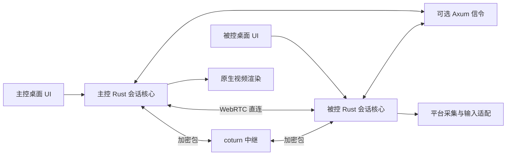

# 技术架构与决策 ADR v0.1

## 决策
- ADR-001 已确认：自主开发，复用成熟底层库；不 fork RustDesk。
- ADR-002 工作基线：Tauri 2 + Vue 3 + TypeScript，Rust 核心/Tokio；具体版本在首次构建时锁定。
- ADR-003 工作基线：WebRTC + ICE/STUN/TURN；信令 Axum + WSS；coturn；SQLite；消息类型以 Protobuf 为目标。最终媒体库及分发方式在 M0 spike 后冻结。
- ADR-004 工作基线：局域网采用本地受控的信令端点与直接身份确认，不依赖公网服务；公网可选自建注册/信令、中继。WebRTC 自身不提供业务身份验证。
- ADR-005 待决：项目许可证、最低支持 OS、媒体引擎/原生渲染与硬件编码分发方案。MIT 是候选而非已授予许可。

## 逻辑架构

信令不转发媒体；TURN 不终止媒体端到端加密。注册与授权不是同一件事。双方确认身份和权限后才启动对应资源。LAN 信令不得默认监听所有地址且不得以“内网可信”替代身份校验。

## 模块边界
| 模块 | 职责 |
|---|---|
| apps/desktop | Tauri 生命周期、Vue UI、窗口、托盘、受限 IPC |
| crates/core | 会话状态机、设备管理、能力协商、服务配置 |
| crates/protocol | 版本化 wire schema、消息类型、大小与语义验证 |
| crates/security | 设备密钥、身份确认、授权校验、信任撤销 |
| crates/transport | WebRTC 适配、ICE、数据通道、连接统计 |
| crates/capture | 屏幕枚举、帧、格式、时间戳、游标 |
| crates/codec | 媒体 pipeline 与编码/解码能力选择 |
| crates/renderer | 原生或零/低拷贝渲染、缩放、坐标映射 |
| crates/input | 键鼠事件、按键状态、坐标映射、权限验证 |
| crates/audio | 音频设备及媒体轨 |
| crates/clipboard | 双向授权、格式与大小限制 |
| crates/file-transfer | 独立流控、校验、冲突策略 |
| crates/platform | OS 权限、后台服务、进程 IPC |
| servers/signaling | 注册、挑战认证、会话路由、限流、TURN 临时凭据 |
| deploy | 自建信令与 TURN，环境变量模板、TLS 与部署文档 |

目录按实际实现逐步建立，不创建无功能占位模块来宣称完成。

## 媒体数据路径
原生屏幕采集 -> 像素缓冲/颜色转换 -> 编码 -> RTP/WebRTC -> 解码 -> 原生窗口 GPU 渲染。Tauri IPC 仅用于控制、事件和统计，禁止逐帧 base64/JSON。GStreamer 优先验证 webrtcbin、平台硬件编码、接收端解码与原生窗口渲染；若不能满足可维护性/打包要求，再比较 libwebrtc 或 webrtc-rs + 独立媒体 pipeline。不能假设这些方案的互操作和硬件能力已经验证。

## 平台适配
| OS | 采集候选 | 输入候选 | 编解码候选 | 注意事项 |
|---|---|---|---|---|
| Windows | WGC / DXGI | SendInput | Media Foundation | DPI、UIPI、安全桌面；服务与用户会话隔离 |
| macOS | ScreenCaptureKit | CGEvent | VideoToolbox | TCC 屏幕录制/辅助功能，签名及权限持久性 |
| Linux X11 | X11/XShm | XTest | VA-API 等 | 显示会话与权限 |
| Linux Wayland | PipeWire + ScreenCast Portal | RemoteDesktop Portal/EIS | VA-API 等 | Compositor 差异；用户授权不可绕过 |

## 数据与部署
本地 SQLite：settings、devices、trusted_peers、session_history、transfer_history；私钥/敏感凭据单独由平台安全存储或受 OS 权限保护的密钥存储管理，禁止硬编码全局密钥。服务器 SQLite 初期仅保留 device_id/public_key/注册状态/必要审计；在线与路由状态短期内存保存。多实例扩展再考虑 PostgreSQL/共享状态。部署可独立替换信令与 coturn，默认无公共实例地址。信令 HTTPS/WSS，TURN UDP/TCP/TLS；按部署环境显式开放防火墙与中继端口，关闭开放匿名 relay。

## 上游参考
- https://v2.tauri.app/concept/architecture/
- https://gstreamer.freedesktop.org/documentation/webrtc/
- https://gstreamer.freedesktop.org/documentation/frequently-asked-questions/licensing.html
- https://github.com/coturn/coturn
- https://developer.apple.com/documentation/screencapturekit
- https://learn.microsoft.com/en-us/windows/win32/direct3ddxgi/desktop-dup-api
- https://flatpak.github.io/xdg-desktop-portal/docs/

## ADR-006：M1 单帧本地诊断实现

Tauri 2/Vue3 桌面应用采用独立 Cargo workspace，避免原生 GUI 依赖污染核心 CI。XCap 0.9.10 是显示器枚举和单次本地 PNG 预览的候选依赖；只在本机明确操作后执行，限制尺寸、并发及频率，不持久化图片、不开放网络服务。Tauri raw IPC 只用于有限的单次诊断，连续媒体不得使用该接口。XCap 并非已冻结的视频引擎；连续屏幕采集、GStreamer/WebRTC 媒体及低拷贝渲染仍需实际验证。平台编译与依赖许可证尚待确认。

## ADR-007：原生 WebRTC 媒体模块

crates/media 独立 Cargo workspace，GStreamer 1.20+ 与 gstreamer-rs 0.23。初始 VP8/RTP，webrtcbin 信令动作、SDP/ICE、有界事件队列，appsrc 接收原生 RGBA、appsink 输出 GstSample。两端进程内信令的合成视频闭环是首个运行门槛，不代表公网或实际桌面可用。M1 单视频 m-line，无 renegotiation、数据通道、TURN 或远程监听。媒体和桌面暂未集成。原生帧接入必须由已验证授权的会话 owner 控制；实际身份确认及双方签名校验前只允许合成媒体或不含敏感像素的占位源，真实采集不得提前进入发送管线。

## ADR-008：ICE 完成消息与本地原生画面验证

GStreamer 1.24+ 的候选完成标记可能是空字符串，不能作为无效候选拒绝。保持单 m-line、消息长度及字符限制。M1 诊断增加 appsrc 原生合成 RGBA 输入与可选 autovideosink 渲染，真实屏幕路径由可选 local-screen feature、交互确认和已连接的两个本进程 peer 约束；仍非生产连续采集方案。禁止对外部设备开放真实屏幕或输入，直至完成实际身份/授权和安全信令。后续替换重复截图为原生连续帧源并优化缩放、宽高比、stride、显示器切换及 GPU 路径。

## ADR-009：独立进程 LAN 诊断

crates/signaling 是 portable workspace 成员，实现版本化、有界 JSON 消息及 TCP 长度帧；只用于单连接诊断，不是生产信令服务。显式绑定指定 loopback/RFC1918 地址，限制候选、消息、总时限；无通配地址、公网监听、注册、TURN 或 TLS。JSON 为该诊断控制面选择；原有 Protobuf 输入数据协议不变。生产信令协议需在 M2 冻结，不能默认将诊断格式直接对公网暴露。

GStreamer 原生模块增加协商型（negotiated）可靠有序 SCTP 数据通道；固定 channel id 0、输入 v1、单通道消息限长/有界队列。为使用 send_data_full 提升该媒体模块运行时最低版本至 GStreamer 1.22；原 VP8 loopback 继续验证。

lan_diagnostic 两端各自生成临时密钥，双方在可信途径确认完整公钥并手动批准测试；显式监听/连接、一次性配对、原始 SDP 双签名、ICE 交换、DTLS/SCTP 连接。仅合成视频与固定测试输入序列，验证 SessionGate 的 action 和释放计划，不调用任何系统输入接口。控制端为生成 answer 必须预先应用 offer；此时不交换实际桌面和敏感数据。生产阶段须进一步完成安全评审、持久信任、身份与连接生命周期绑定、加密信令及真实同意流程。
